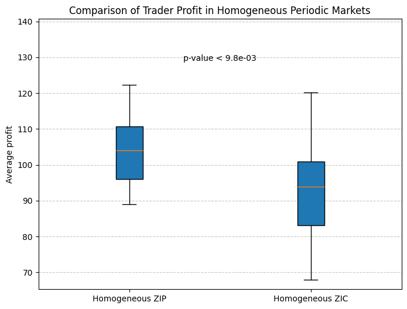
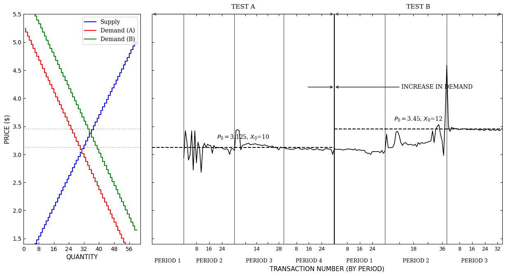
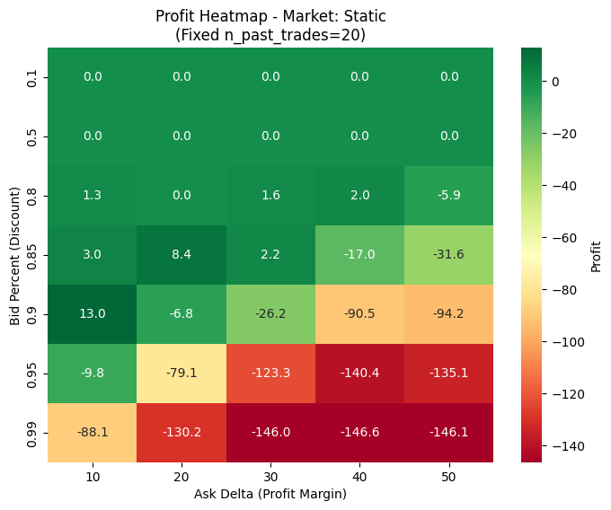
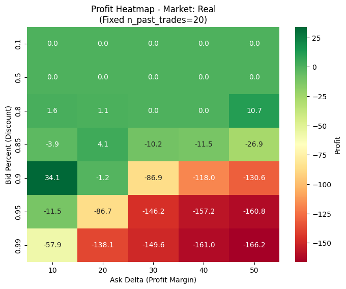
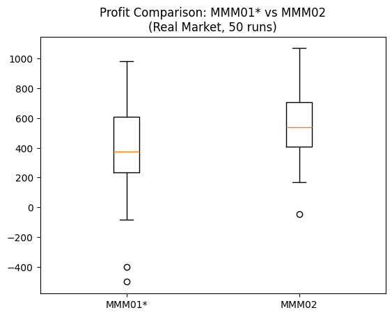

# Algorithmic Market Simulation and Adaptive Market-Maker Design

This project uses the Bristol Stock Exchange simulator to test how automated traders discover prices and how market-maker logic affects profitability. The work progresses from controlled ZIP and ZIC benchmarking to a Smith-style demand shock, a 4,200-session MMM01 parameter search, and a redesigned MMM02 strategy. With both market makers using the same tuned parameters in the same IBM-offset environment, MMM02 increased mean profit from 398.70 to 552.13 across 50 paired runs, a 38.5% improvement with p = 0.0068.

The main contribution is a staged experimental workflow that connects market microstructure, statistical testing, parallel simulation and trading-strategy design. Each step informs the next: the first experiments test agent behaviour and price discovery, the grid search selects MMM01*, and the final paired comparison isolates the effect of the new MMM02 logic.

## Results at a glance

| Analysis | What was tested | Main finding |
|---|---|---|
| ZIP and ZIC benchmark | 20 homogeneous sessions per strategy | ZIP earned 11.1% more mean profit with lower across-run variation; Welch p = 0.0098 |
| Demand shock | Seven periods with demand raised after period four | Prices converged toward 3.125, then adjusted toward the new 3.45 equilibrium |
| MMM01 search | 210 parameter-market combinations, each repeated 20 times | 4,200 simulations identified settings that performed best in the IBM-offset market |
| MMM02 comparison | 50 paired runs against tuned MMM01* | The strategy redesign raised mean profit by 153.43, or 38.5%; paired p = 0.0068 |

## 1. Trading-agent benchmark

The first experiment compares homogeneous markets populated by ZIP or ZIC traders. Each strategy is evaluated over 20 sessions with the same market schedule and population size.



ZIP produced mean profit of 104.23, compared with 93.82 for ZIC. Its standard deviation was also lower, at 9.24 rather than 13.74. The 10.41 profit difference is about 11.1% of the ZIC result, and Welch's unequal-variance t-test reports p = 0.0098. Under the same symmetric market conditions, ZIP's adaptive margin learning produced a higher and more stable result than random quoting.

## 2. Demand shock and price discovery

The second experiment recreates a controlled demand increase across seven trading periods. The first four periods use the initial schedule; the final three use higher buyer valuations.



The first period produced no trades while the agents lacked price history. Activity then recovered to 32, 31 and 32 trades as ZIP adapted and prices converged around the initial equilibrium of 3.125. After the demand increase, period volumes were 32, 39 and 35, while transaction prices moved toward the new equilibrium of 3.45. The experiment reproduces both competitive price discovery and market repricing after an external shock with heterogeneous automated agents.

## 3. MMM01 parameter optimisation

MMM01 is evaluated over three lookback windows, seven bid percentages, five ask margins, and two market environments. Twenty trials are run for each parameter-market combination, giving 4,200 simulations in total.

| Static market | IBM-offset market |
|---|---|
|  |  |

The search uses `ProcessPoolExecutor` and collects results in memory instead of writing a file for every session. The saved run completed all 4,200 simulations in 3 minutes 38 seconds.

The heatmaps use `n_past_trades=20`, the lookback with the highest average profit across the bid and ask grid in both environments. Across all individual cells, the strongest static-market configuration uses `n_past_trades=10`, `bid_percent=0.9`, and `ask_delta=10`, with mean profit of 15.35. Under the IBM offset schedule, the best configuration uses `n_past_trades=20`, `bid_percent=0.9`, and `ask_delta=10`, with mean profit of 34.15. Testing both synthetic and market-derived price schedules avoids selecting parameters from a single regime. The IBM result is carried forward as MMM01* because the final comparison uses the same environment.

## 4. Adaptive market-maker strategy

The adaptive engine modifies MMM02 in three practical ways:

- a short- and long-term moving-average filter pauses buying during a downtrend;
- the trader hits the best bid when it covers purchase cost plus a minimum profit;
- otherwise, it undercuts the best ask while preserving the minimum profit constraint.

MMM01* and MMM02 use identical tuned parameters and trade in the same IBM-offset market for 50 paired runs. This design keeps the comparison focused on the strategy logic rather than parameter selection.



MMM02 achieved mean profit of 552.13, compared with 398.70 for MMM01*. The increase of 153.43 is a 38.5% improvement, and the paired difference is statistically significant at the 1% level (p = 0.0068). In this experimental setting, the combination of trend-aware inventory control, faster profit-taking and more competitive quoting produced a clear improvement over MMM01*.

## Repository contents

| File | Purpose |
|---|---|
| `01_zip_vs_zic_profitability.ipynb` | Benchmarks ZIP and ZIC profitability. |
| `02_smith_market_shock_simulation.ipynb` | Tests price discovery after a demand shift. |
| `03_market_maker_parameter_optimisation.ipynb` | Runs the MMM01 parameter search in two market environments. |
| `04_adaptive_market_maker_strategy.ipynb` | Compares tuned MMM01 with the modified MMM02 strategy. |
| `bse.py` | Bristol Stock Exchange simulation engine. |
| `bse_adaptive.py` | BSE variant containing the modified MMM02 strategy and comparison output. |
| `market_maker_grid_search.py` | Worker function for independent MMM01 search runs. |
| `market_maker_comparison.py` | Worker function for the paired MMM01 and MMM02 experiment. |
| `data/ibm_price_offsets.csv` | IBM price-offset schedule used by the dynamic-market experiments. |

## Running the notebooks

Use Python 3.12 or a compatible recent Python version. From the repository root:

```bash
python -m venv .venv
```

Activate the environment, then install the dependencies:

```bash
pip install -r requirements.txt
```

Open the notebooks in Jupyter or VS Code. They include saved outputs, so the reported results can be reviewed without rerunning the simulations. Run them from the repository root when reproducing the experiments because the notebooks import local Python modules and read `data/ibm_price_offsets.csv` by relative path.

The MMM01 search is the largest experiment: it launches 4,200 BSE sessions through `ProcessPoolExecutor`. The final MMM01 and MMM02 comparison launches 50 paired sessions.

## Sources and attribution

- Dave Cliff, [Bristol Stock Exchange](https://github.com/davecliff/BristolStockExchange), the original limit-order-book simulator and source of the IBM offset file.
- Dave Cliff, [BSE: A Minimal Simulation of a Limit-Order-Book Stock Exchange](https://arxiv.org/abs/1809.06027), 2018.
- Vernon L. Smith, [An Experimental Study of Competitive Market Behavior](https://doi.org/10.1086/258609), 1962.
- [Original IBM price-offset file](https://github.com/davecliff/BristolStockExchange/blob/master/offset-ibm-1m-170831.csv) in the BSE repository.

The BSE source retains Dave Cliff's copyright notice and MIT terms. The modified engine and the remaining project code are distributed under the same license; see [LICENSE](LICENSE).
